  
  
  
  

## About me

Java Backend Engineer with 3 years across interbank payments, digital signature, and multi-tenant SaaS. I build the service, then set up and release it to production.

- Backend Software Engineer at **Wala-ICT**, building software products for Korean clients
- Previously on the digital signature and banking team at **Unit Technology Corporation**
- Highest Potential Employee 2025, LPI Linux certified

## Featured work

| Project | What it is | What I did |
| --- | --- | --- |
| [**Signature Hub**](https://portfolio.vinhnq.com/projects/signature-hub/) | Centralized digital signing platform | Event-driven signing on Kafka, HSM integration |
| [**ACH Gateway**](https://portfolio.vinhnq.com/projects/ach-gateway/) | NAPAS interbank payment gateway | ISO 20022 inward deposits, reconciliation |
| [**S-Space**](https://portfolio.vinhnq.com/projects/s-space/) | Pilates and fitness studio SaaS | Production releases on ECS Fargate, payment reconciliation |
| [**BitBuild**](https://portfolio.vinhnq.com/projects/bitbuild/) | Multi-tenant procurement SaaS | Hexagonal architecture, idempotent purchase flows |

[See all projects and live system simulations →](https://portfolio.vinhnq.com/projects/)

## Tech stack

**Backend**

**Cloud and DevOps**

